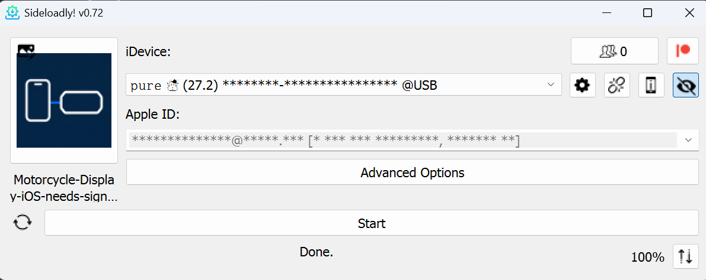

# จอรถ iOS 1.10.1 (build 15)

iOS 15 ขึ้นไป · repository นี้มีไฟล์ติดตั้ง IPA คู่มือ และภาพตัวอย่าง ไม่มีซอร์สโค้ดแอป

[ดาวน์โหลด IPA รุ่นล่าสุด](https://github.com/name-pure/ridescreen-ios-ipa/releases/download/v1.10.1-build15/Motorcycle-Display-iOS-needs-signing.ipa)

UI ใหม่แนว Atlas ทั้ง 4 แท็บ **เชื่อมต่อ / นำทาง / Mirror / ตั้งค่า** และข้อความบนจอรถ สลับไทย/อังกฤษได้ ใช้ฟอนต์ Noto Sans Thai แบบฝังในแอป เปลี่ยนชื่อบน iPhone เป็น **จอรถ** และชื่อใน Screen Broadcast เป็น **Screen Share** ชื่อบนจอรถเริ่มต้นว่างและตั้งเองได้

คง OpenStreetMap, OpenFreeMap, Apple Maps, Wide map และ Custom การสลับแท็บหรือภาษาเก็บสถานะเชื่อมต่อและจุดหมายไว้

## แก้การรอเครือข่ายในรุ่น 1.10.1

- การเชื่อมต่อหลักรอให้ Wi-Fi ฟื้นตัวจากสถานะ `waiting` ได้จนถึงกำหนด 4 วินาที แทนการยกเลิกทันที
- ล็อกการเชื่อมต่อแสดง path / reason / interface และเก็บข้อผิดพลาดล่าสุดเมื่อหมดเวลา
- หยุดงาน probe เก่าและป้องกัน timer/retry ของรอบเก่ารบกวนเมื่อกดหยุดแล้วเริ่มใหม่
- ปุ่มคัดลอกข้อมูลวิเคราะห์ใน Settings รวมผลสแกน IP/พอร์ตครั้งล่าสุด พร้อมเวลาเริ่มตรวจและสถานะ ส่งจากปุ่มเดิมได้เลย

การแก้นี้รองรับเครือข่ายที่ไม่พร้อมชั่วคราว ยังไม่ยืนยันว่าจะแก้ `Network is down` ที่ค้างตลอดได้ ต้องทดสอบ Wi-Fi และโปรโตคอลกับ 368G v.2 จริง

## ตรวจพอร์ตจาก iPhone ในรุ่น 1.10.0

เพิ่ม **เชื่อมต่อ → ตรวจเครือข่ายจอรถ** ไม่ต้องใช้คอมและไม่ต้องมีอินเทอร์เน็ต

1. ต่อ Wi-Fi จอรถและหยุดแสดงผล/Mirror ก่อน แล้วเปิด **ตรวจเครือข่ายจอรถ**
2. เริ่มพอร์ต **10930** ช่อง IP เว้นว่างได้ กด **ตรวจ IP ที่คาดไว้**
3. หากยังไม่พบ กด **สแกนวง Wi-Fi** ตรวจพอร์ตเดียวกันสูงสุด 254 IP ใกล้เคียง ใช้ประมาณ 3 นาที หยุดได้ทุกเมื่อ
4. ถ้าพบ TCP 10930 ที่เชื่อมได้ กด **ใช้ IP นี้** แล้วกดเริ่มแสดงผลเอง แอปไม่เริ่มเชื่อมต่อจอรถอัตโนมัติ
5. หากยังไม่ได้ กด **คัดลอกผลตรวจเครือข่าย** เพื่อส่ง IP, path/reason และผล TCP มาวิเคราะห์ต่อ

แสดงผลแยกเชื่อม TCP ได้ / ถูกปฏิเสธ / หมดเวลา / เส้นทาง Wi-Fi ไม่พร้อม / สิทธิ์ Local Network ไม่อนุญาต เปลี่ยนเลขพอร์ตเพื่อตรวจพอร์ตอื่นได้ แต่ปุ่มใช้ IP มีเฉพาะผล 10930

การตรวจส่งเพียง TCP connect ไม่ส่ง handshake หรือคำสั่งจอรถ สแกนเฉพาะวง Wi-Fi ส่วนตัวที่ต่ออยู่ ไม่สแกนอินเทอร์เน็ต และหยุดเมื่อออกจากแอปหรือปิดหน้าตรวจ รายงานไม่มีรหัสผ่าน Wi-Fi หรือ Mapbox token

**พอร์ตเปิดยังไม่ยืนยันว่าโปรโตคอลรองรับจอรถ** รวมถึง 368G v.2 ต้องทดสอบการจับมือและภาพจริงเพิ่มเติม

## เพิ่ม Mapbox ในรุ่น 1.9.0

Mapbox เป็นตัวเลือกใหม่บน iPhone และจอรถ ใช้หน้าเลือกหมุด ภาพรวมเส้นทาง และแผนที่บนจอรถได้ เลือกรูปแบบถนน / กลางแจ้ง / สว่าง / มืด

1. ไป **ตั้งค่า → Mapbox** วาง **Public token ที่ขึ้นต้นด้วย `pk.`** ของบัญชีคุณ แล้วกด **บันทึกคีย์** ต้องบันทึกก่อนใช้ Mapbox
2. กด **ทดสอบ Mapbox** เพื่อลองโหลดภาพ จากนั้นกด **ใช้ Mapbox**
3. ครั้งต่อไปแอปจำคีย์ใน **Keychain เฉพาะ iPhone เครื่องนี้** คีย์ไม่รวมใน IPA, GitHub หรือข้อมูลวิเคราะห์ปัญหา ไม่ส่งค่ากลับมาแสดงในช่องกรอก การโหลดภาพส่งคีย์ผ่าน HTTPS ไปยัง Mapbox
4. เปลี่ยนหรือลบได้ใน **คีย์และรูปแบบ Mapbox** เมื่อลบขณะใช้ Mapbox จอรถจะเปลี่ยนไปใช้ OpenStreetMap โดยคงการเชื่อมต่อ

คีย์ต้องมีสิทธิ์ `styles:tiles` ไม่รองรับ Secret token (`sk.`) ดู [การตั้งค่า token](https://docs.mapbox.com/accounts/guides/tokens/)

ใช้ **Static Tiles API** คิดตามคำขอภาพแผนที่ ใช้โควตาและอาจมีค่าใช้จ่ายในบัญชีของคุณ เก็บภาพร่วมกันในหน่วยความจำเพื่อลดคำขอซ้ำ ดู [ราคา Mapbox](https://www.mapbox.com/pricing/) การนำทางใช้ระบบเส้นทางมอเตอร์ไซค์เดิม

โหมดปิดจอใช้ CPU เช่นเดียวกับแผนที่ CPU เดิม ยังต้องทดสอบการล็อกจอและเครือข่ายบน iPhone/จอรถจริง คีย์จริงของคุณไม่ได้ใช้ในระบบ build ให้กด **ทดสอบ Mapbox** บน iPhone หลังติดตั้ง

## แก้ไขในรุ่น 1.8.1

- รองรับลิงก์ Google Maps ที่ส่งมาเป็นชื่อธุรกิจพร้อมที่อยู่ยาว หากค้นหาไม่สำเร็จจะลองชื่อสถานที่ที่สั้นลง และให้เลือกยืนยันผลลัพธ์ก่อนเริ่มนำทาง
- ค้นหาชื่อจากลิงก์ด้วย Apple Maps ก่อน แล้วใช้บริการสำรองตามตัวแสดงแผนที่ที่เลือก โดยไม่เปลี่ยนแผนที่บนจอรถ
- แยกข้อความเปิดลิงก์ไม่ได้ / เปิดได้แต่ค้นหาสถานที่ไม่พบ เพื่อให้แก้ไขได้ตรงจุด
- ลิงก์ที่แนบพิกัดและลิงก์ Apple Maps ยังใช้พิกัดโดยตรงตามเดิม

ลิงก์ Google ที่มีแต่ชื่อจะใช้การค้นหา จึงต้องตรวจชื่อ ที่อยู่ และตำแหน่งก่อนเลือก ไม่รับประกันว่าทุกร้านมีข้อมูลตรงกันระหว่างผู้ให้บริการ หากไม่พบ ใช้ปักหมุดหรือแชร์ลิงก์ที่มีพิกัดได้

## ฟังก์ชันจากรุ่น 1.8.0

- เลือกจุดหมายแล้วดูภาพรวมเส้นทางก่อนเริ่ม พร้อมเวลา ระยะทาง และเส้นทางสำรองสูงสุด 3 ทางตามข้อมูลที่มี
- เปิด/ปิดเลี่ยงทางด่วนและทางเสียค่าผ่านทางได้ ค่าเริ่มต้นเปิดทั้งสอง และใช้ตัวเลือกเดียวกันเมื่อคำนวณใหม่หลังออกนอกเส้นทาง
- เปลี่ยน OpenStreetMap / OpenFreeMap / Apple Maps ขณะเชื่อมต่อจอรถได้ โดยไม่สั่ง Disconnect/Connect ใหม่
- Mirror ใช้รุ่นเดิมที่ยืนยันว่าใช้งานได้ กดปุ่ม Record ค้างเพื่อเริ่มแชร์

## ติดตั้งบน Windows

1. ดาวน์โหลด IPA ลงคอม เปิด [Sideloadly](https://sideloadly.io/) และทำตามข้อกำหนดไดรเวอร์/iTunes/iCloud จากเว็บไซต์ทางการ
2. ต่อ iPhone ผ่าน USB ปลดล็อกและกด **Trust** เลือก iPhone ใน Sideloadly
3. ลาก IPA ลง Sideloadly ใช้ Apple Account และ Bundle ID เดิมเพื่ออัปเดตทับแอปเดิม
4. **เก็บ ScreenBroadcast extension ไว้** หากมี **Remove app extensions** ให้ปิด เพื่อให้ Mirror ทำงานได้
5. กด **Start** กรอกรหัสผ่าน/รหัสยืนยันใน Sideloadly ตามที่ระบบถาม รอจนติดตั้งเสร็จ
6. หากขึ้น **Untrusted Developer:** Settings → General → VPN & Device Management → บัญชีผู้พัฒนา → Trust
7. หากขึ้น **Developer Mode Required:** Settings → Privacy & Security → Developer Mode → เปิด แล้ว Restart และยืนยัน Turn On

ตัวอย่างเมื่อติดตั้งเสร็จ: Sideloadly แสดง **Done.** และ **100%** จากนั้นเปิดแอป **จอรถ** บน iPhone ได้

แตะ IPA ใน Files อย่างเดียวติดตั้งไม่ได้ บัญชีฟรีต้องเซ็นใหม่ตามอายุใบรับรอง ใช้ Auto Refresh หรือต่อคอมแล้วติดตั้งทับด้วยบัญชีเดิม ดู [FAQ ทางการ](https://sideloadly.io/faq) สำหรับเงื่อนไขและการแก้ปัญหา

## เริ่มเชื่อมต่อและนำทาง

1. เปิด **จอรถ** → แท็บ **เชื่อมต่อ** แล้วสแกน QR บนจอรถ หรือกด **วางลิงก์ QR**
2. ไป Settings → Wi-Fi เชื่อมเครือข่ายของจอรถ และเปิด Cellular Data ไว้
3. กลับแอป กด **เริ่มแสดงผล**
4. แท็บ **นำทาง** ใช้ค้นหาสถานที่ วางลิงก์ Google/Apple Maps หรือปักหมุด แตะจุดหมายเพื่อเลือกเส้นทาง ปรับตัวเลือกเลี่ยง เลือกเส้นทางที่ต้องการ แล้วกด **เริ่มนำทาง**
5. แท็บ **ตั้งค่า** เลือกแผนที่, 3 ส่วน / แผนที่เต็มจอ / กำหนดเอง และตั้งชื่อบนจอ เปลี่ยนไทย/EN ได้ในหัวแอปหรือหน้า Settings

## ใช้ Mirror

1. เชื่อม Wi-Fi จอรถก่อน แล้วเลือก **Mirror → เตรียมแชร์หน้าจอ / Prepare mirror** ขั้นตอนนี้หยุดแดชบอร์ดและการนำทางเดิม
2. กดปุ่ม **Record / บันทึกหน้าจอ ค้างไว้** เพื่อเลือก **Screen Share → Start Broadcast** แล้วรอนับถอยหลัง ตามวิธีที่ผู้ใช้ยืนยันว่าใช้ได้
3. เมื่อแชร์แล้ว ปุ่มเปิด Apple Maps, Google Maps, Waze, Spotify และ Apple Music จะใช้ได้ เปิดแอปที่ติดตั้งอยู่แล้วและควบคุมจาก iPhone หมุนแนวนอนเพื่อใช้พื้นที่จอรถมากขึ้น
4. หยุดจาก Control Center หรือกลับแอป → **หยุดแชร์หน้าจอ / Stop screen sharing**

Mirror ต้องเปิดจอและปลดล็อก iPhone ส่งเฉพาะภาพ เสียงใช้หูฟัง/อินเตอร์คอม Bluetooth การแจ้งเตือนอาจปรากฏบนจอรถ โหมดนี้ไม่ใช่ CarPlay และใช้พร้อมแดชบอร์ดไม่ได้

## นำทางขณะปิดจอ

เลือก OpenStreetMap หรือ OpenFreeMap ใน **ตั้งค่า** เปิด **นำทางขณะปิดจอ (รุ่นทดลอง)** เชื่อมต่อและเริ่มนำทางขณะเปิดแอปก่อนล็อกด้วยปุ่มด้านข้าง อย่าปัดปิดแอป Apple Maps แบบฝังยังต้องเปิดแอปนี้อยู่ด้านหน้า และ Mirror ต้องเปิดจอไว้

เส้นทางคำนวณด้วยโปรไฟล์รถจักรยานยนต์และข้อมูลแผนที่ ตรวจป้ายกับข้อห้ามจริงก่อนใช้ทางด่วน/มอเตอร์เวย์

## การตรวจรุ่นนี้

ตรวจ build, Flutter tests 57 กรณี และ native tests พร้อมทดสอบลิงก์ Google/Apple จริงและการค้นหาชื่อผ่านบริการ Apple Maps บนเครื่อง build แล้ว ตรวจการเชื่อม TCP จริงแบบ loopback, การจำกัดช่วง/จำนวนงานสแกน, การยกเลิก และหน้าตรวจเครือข่ายบนตัวจำลอง iPhone/iPad ด้วยผลจำลอง การสแกน Wi-Fi จอรถจริงยังต้องทดสอบบนอุปกรณ์ของผู้ใช้ การติดตั้งและเครือข่ายบน iPhone/จอรถจริงยังต้องทดสอบกับอุปกรณ์ของผู้ใช้
